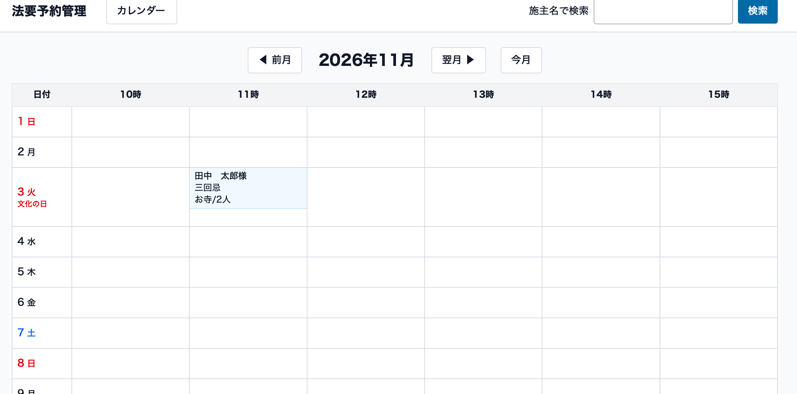
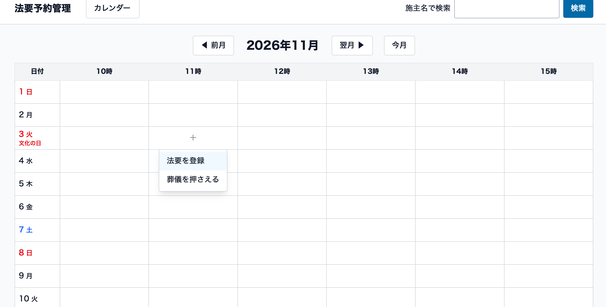
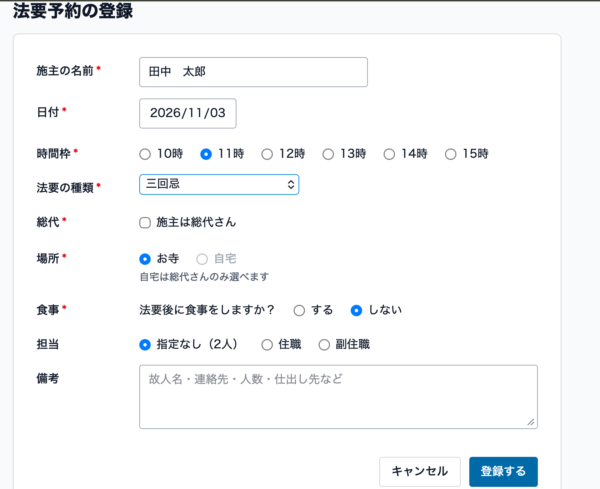
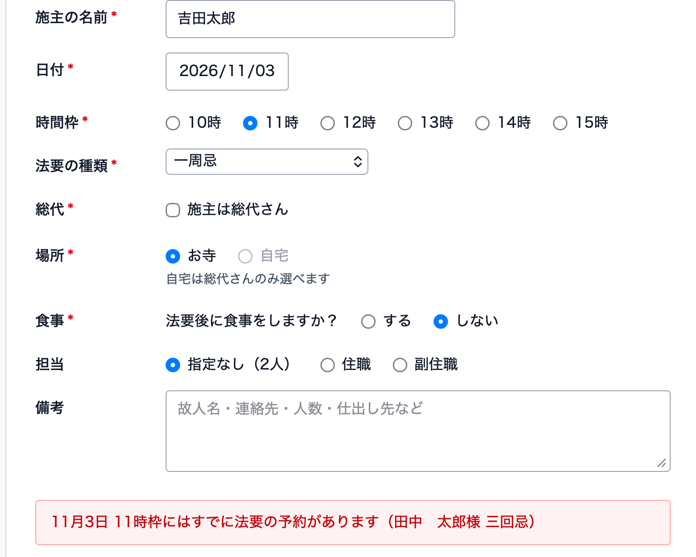
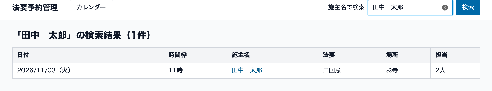

# 法要予約管理アプリ（temple-reservation）

お寺の職員が、檀家さんから電話で受けた法要の予約を管理する Web アプリです。
紙のカレンダーと Google カレンダーの二重管理をやめて予約を1か所にまとめ、予約の重複をシステムで防ぎます。

**公開 URL：http://52.198.9.123/**

> ログイン機能・IP 制限・HTTPS は、講師のレビューを優先して今回（初級編）は入れていません。URL を知っている人は誰でも予約を見たり変えたりできるため、**本物の個人情報は入力せず、ダミーデータで確認してください。**



## 目次

- [画面](#画面)
- [工夫した点](#工夫した点)
- [主な機能](#主な機能)
- [予約のルール](#予約のルール)
- [技術スタック](#技術スタック)
- [AWS 構成](#aws-構成)
- [ローカルでの起動方法](#ローカルでの起動方法)
- [テスト](#テスト)
- [ディレクトリ構成](#ディレクトリ構成)
- [ドキュメント](#ドキュメント)
- [今後の予定](#今後の予定)

## 画面

| 月カレンダー（空き枠から登録） | 法要予約の登録 |
| --- | --- |
|  |  |
| 縦に日付、横に時間枠。1か月を1画面で見渡せる。土曜は青、日曜・祝日は赤 | 電話を受けながら1画面で入力できる。自宅は総代さんのときだけ選べる |

| 二重予約を止める | 施主名で検索 |
| --- | --- |
|  |  |
| 同じ枠に法要があると、先に入っている予約が分かるメッセージで止める | 部分一致で、過去の予約も新しい順に探せる |

## 工夫した点

### 1. お寺の実際の業務から要件を決めた

最初にお寺の業務（電話で受付 → 紙のカレンダーに記入 → あとで Google カレンダーにも入力）を整理し、決まっていないことを **確認事項 Q-1〜Q-10** としてお寺に確認しました。回答はすべて要件定義書の「決定事項」に記録し、ルールに反映しています。

| お寺の実情 | アプリでの決め方 |
| --- | --- |
| 住職と副住職がいて、二手に分かれて対応できる | 法要と葬儀は同じ時間枠に入れられる。担当の重なりはチェックしない（R-2・R-5） |
| 葬儀は1日に1件まで。詳細の管理はいらない | 葬儀は日時だけを「押さえ」として登録し、1日1件に制限する（R-3） |
| 法要は基本お寺で行い、総代さんだけ特例で自宅でもできる | 「総代」にチェックしたときだけ「自宅」を選べる（R-6） |
| 法要は30分ほどで終わる | 自宅の法要でも、移動のために前後の枠を空ける制限は付けない |
| 法要は基本2人で務める | 担当は任意。指定なしは「2人」と表示する |
| 法要のあとに食事をするかを確認したい | 当初の「会場（客殿／観音堂）」の欄をなくし、「法要後に食事をしますか？」を聞く |
| 予約は電話で受ける | 1画面で入力が終わるフォーム。カレンダーの空き枠から開くと日付・時間枠が入った状態になる |
| 百か日・初盆は件数が少ない | 法要の種類は四十九日〜五十回忌と「その他」に絞る |

実装のあとに出た仕様変更（会場の削除、担当を任意に）も、要件定義書・設計書・DB・API・画面をそろえて直しています。

### 2. 予約の重複を3段階で防ぐ

| 段階 | 役割 |
| --- | --- |
| 画面（Next.js） | 選べない選択肢を出さない（例：法要が入った枠のメニューには「葬儀を押さえる」だけを出す） |
| API（Rails のモデル） | ルールの正式な判定。先に入っている予約が分かる日本語のメッセージを返す |
| DB（MySQL の制約） | 一意制約・CHECK 制約で最後に必ず止める |

2人の職員がほぼ同時に同じ枠へ登録した場合も、DB の一意制約で後の登録を止め、通常の重複と同じメッセージを返します（RSpec でテスト済み）。

### 3. 職員が使いやすい画面

- エラーの後も入力内容を消さない。直した欄のエラーはすぐ消える
- 削除の前に「11月20日 10時 山田太郎様 一周忌 を削除しますか？」と確認する
- 登録・更新・削除のあとは、その予約の月のカレンダーに戻り「登録しました」などを表示する
- 施主名検索は、ひらがな・カタカナを区別しない（電話で聞いた読みでも探せる）

## 主な機能

| 機能 | 内容 |
| --- | --- |
| 月カレンダー | 1か月の予約を1画面で表示。前月・翌月・今月へ移動。祝日を表示 |
| 法要予約の登録・編集・削除 | 施主名・日付・時間枠・法要の種類・総代・場所・食事・担当・備考 |
| 葬儀の押さえ | 葬儀のために時間枠を確保する（名前・日付・時間枠・備考だけ） |
| 施主名検索 | 部分一致。過去の予約も含め、新しい順に表示 |

## 予約のルール

時間枠は **10時〜15時開始の1時間枠（6枠）** です。

| No | ルール | 内容 |
| --- | --- | --- |
| R-1 | 法要は1枠1件 | 同じ日・同じ時間枠の法要は1件まで |
| R-2 | 葬儀は法要と別枠 | 葬儀の押さえがある枠でも、法要を1件受けられる |
| R-3 | 葬儀は1日1件 | 時間枠が違っても、同じ日の2件目は登録できない |
| R-5 | 担当の重なりは止めない | 住職と副住職が二手に分かれて対応するため |
| R-6 | 自宅は総代のみ | 法要の場所は基本お寺。総代さんだけ自宅を選べる |

R-4（会場は1枠1件）は、会場の項目をなくしたため欠番です。

## 技術スタック

| 区分 | 技術 |
| --- | --- |
| フロントエンド | Next.js 16（App Router）・React 19・TypeScript 5・Tailwind CSS 4・@holiday-jp/holiday_jp（祝日） |
| バックエンド | Ruby 4.0.9・Ruby on Rails 8.1（API モード）・Puma |
| DB | MySQL 8.4.13（開発は Mac の Homebrew、本番は Amazon RDS） |
| テスト・チェック | RSpec（rspec-rails 8.1）・FactoryBot・RuboCop・ESLint |
| インフラ | AWS（EC2・RDS）・Terraform 1.17（AWS プロバイダ 6.x）・Amazon Linux 2023・Nginx・systemd |

### 前回（タスク管理アプリ）から変えたこと

| 区分 | 前回 | 今回 | 変えた理由・ねらい |
| --- | --- | --- | --- |
| フロントエンド | React + Vite（JavaScript） | **Next.js + TypeScript** | 画面が6つになり、URL ごとに画面を分けたい。API の型を画面と共有して、項目名の間違いを防ぐ |
| バックエンド | Java 21 + Spring Boot 4（Gradle） | **Ruby + Rails（API モード）** | モデルのバリデーション・マイグレーション・日本語メッセージ（i18n）で、予約ルールを短く書ける |
| DB | PostgreSQL 17（Docker） | **MySQL 8.4**（Homebrew・RDS） | 指定の構成に合わせた。8.0 はサポートが終わっていたため、長期サポート版の 8.4 にした |
| テスト | JUnit・Mockito | **RSpec・FactoryBot** | 予約ルールをモデルと API の両方でテスト（111件） |
| 本番での動かし方 | Vite の開発サーバー（5173番）を直接公開 | **Nginx（80番）＋ systemd** で Rails・Next.js を本番モードで起動 | 再起動しても自動で立ち上がる。3000・3001番は外に開けない |
| 公開範囲 | 自分の IP だけ | **80番はどこからでも**（SSH は自分の IP だけ） | 講師がレビューで見られるようにするため |
| 公開 IP | EC2 の自動の IP（止めると変わる） | **Elastic IP**（固定） | EC2 を止めて起動しなおしても URL が変わらない |
| Terraform | — | 前回の `network.tf`・パスワードの作り方などを流用し、MySQL 用・80番公開・Elastic IP に変更 | 必要な部分だけを流用した |

## AWS 構成

```
                    インターネット
                         │ HTTP 80（どこからでも）／ SSH 22（開発者の IP だけ）
┌────────────────────────┼──────────────── AWS 東京リージョン ─┐
│ VPC 10.0.0.0/16        │                                     │
│ ┌─ 公開サブネット ──────▼───────────────────────────────┐  │
│ │ EC2 t3.micro（Amazon Linux 2023）＋ Elastic IP          │  │
│ │   Nginx :80 ─┬─ /api/・/up ─▶ Rails（Puma）127.0.0.1:3001 │  │
│ │              └─ それ以外 ───▶ Next.js     127.0.0.1:3000 │  │
│ └──────────────────────────────┬──────────────────────────┘  │
│                                 │ 3306（EC2 からだけ）          │
│ ┌─ 非公開サブネット ×2（1a・1c）▼──────────────────────────┐  │
│ │ RDS MySQL 8.4.13 db.t4g.micro（シングル AZ・20GB）       │  │
│ └──────────────────────────────────────────────────────────┘  │
└────────────────────────────────────────────────────────────────┘
```

| 項目 | 内容 |
| --- | --- |
| 使うサービス | EC2（Elastic IP を含む）と RDS だけ。NAT ゲートウェイ・ロードバランサーは使わず、なるべく小さいサイズにした |
| 秘密の値 | DB のパスワードは Terraform がランダムに作り、`terraform.tfstate` と EC2 の `/etc/temple-reservation/backend.env` にだけ置く（GitHub には上げない） |
| ログ | 施主名・名前・備考は Rails のログで `[FILTERED]` と伏せる |
| 費用の目安 | 24時間動かして月 約 $36.5（RDS が約半分）。使わない期間は `terraform destroy` で消す |

構築の手順は [infra/README.md](infra/README.md)、デプロイの手順は [docs/deploy.md](docs/deploy.md) にあります。

## ローカルでの起動方法

必要なもの：Ruby 4.0.9、MySQL 8.4、Node.js 26

```bash
git clone https://github.com/kynkt-rgb/temple-reservation.git
cd temple-reservation

# バックエンド（http://localhost:3001）
cd backend
bundle install
bin/rails db:prepare     # DB をつくってテーブルを用意する
bin/rails server

# フロントエンド（http://localhost:3000）。別のターミナルで
cd frontend
npm install
npm run dev
```

ブラウザで http://localhost:3000 を開きます。開発中は、画面からの `/api` を Next.js が Rails（3001番）に取り次ぎます。

## テスト

```bash
cd backend
bundle exec rspec        # モデル・API のテスト（111件）
bin/rubocop

cd ../frontend
npm run lint
npx tsc --noEmit
npm run build
```

画面の動き（登録・編集・削除・予約ルールのエラー表示など 45 項目）は、ヘッドレスブラウザで開発環境と本番の両方を確認しています。

## ディレクトリ構成

```
temple-reservation/
├── docs/        要件定義書・基本設計書・デプロイ手順・スクリーンショット
├── frontend/    Next.js（画面）
├── backend/     Rails（API モード）
├── infra/       Terraform（AWS の EC2・RDS）
└── deploy/      EC2 へのデプロイ（Nginx・systemd・スクリプト）
```

## ドキュメント

- [要件定義書](docs/requirements.md)：背景・業務フロー・予約のルール・お寺への確認事項と決定事項
- [基本設計書](docs/basic-design.md)：画面・DB・API・入力チェック・インフラの設計
- [デプロイ手順](docs/deploy.md)
- [AWS の構築（Terraform）](infra/README.md)：使い方・費用の目安

## 今後の予定

- ログイン機能（中級編）
- IP 制限またはログイン機能による利用者の限定
- ドメイン取得と HTTPS 化
- Google カレンダー連携
